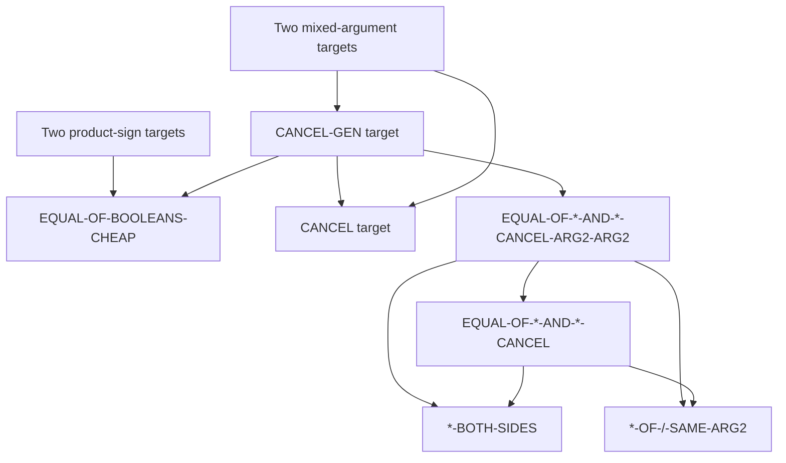

# NS1-R execution record

Dated 2026-09-07. Implements the
[focused plan](../plans/2026-09-07_ns1-replay-mechanisms-plan.md).
**In progress: R1 scope frozen; query captures and selected clause edits underway.**
The [supported scope](2026-09-07_ns1-r-supported-scope.md) records the cases,
module contracts, integration bounds and subsequently selected reuse witnesses.
The selected clause-edit fragment closes the first required CANCEL proof.
Shared query consumption and residual clause construction remain incomplete.

## Baseline and preservation

The goal was activated with the objective in the user's attached text.
The preceding interrupted activation made no implementation progress;
process inspection found no surviving ACL2Lean build or capture to resume.
Work continues in `mdd/ns1-bvchop`. The planning documents are checkpointed
at `7369381`, following implementation HEAD `7598d0a`.

The inherited diff is limited to `NumericComponents.lean`,
`Replay/Driver/ComplexViews.lean`, and `Replay/Driver/Discharge.lean`.
It adds primitive component/negation normalization inside actual emitted
verdict leaves. It does not add an ordinary theorem to the core registry.
The source inspection and a copy of this exact patch precede new replay
implementation; its separate fast-gate checkpoint is `435a26f`.

[The R0 manifest](2026-09-07_ns1-r-baseline.json) records 22 source/capture/image identities,
the inherited patch hash, Lean 4.33.0, production ACL2
`fd27e59021cf7d0103a526dbda41553ad709eae3`, and diagnostic ACL2
`df7a28e38c5122d987fc0bc3c19a0db3895105b6`. The diagnostic checkout is clean.
All 55 source hashes in the selected bootstrap capture's diagnostic manifest
match that checkout. Its saved image matches the earlier successful build
record and the times capture's image timestamp. The captured image core is
241,948,208 bytes, SHA-256
`5c28de5c83d5b42d4f225cf698fd17f13df7dfbe502678c4ca5b64841a168f2f`.
These are engineering provenance checks, not a kernel guarantee of attribution.
Available disk at entry: 1.1 TiB; no cleanup was needed.

Fresh R0 commands, from the NS1 worktree:

```sh
lake env bash -c 'export LEAN_PATH="$PWD/.tmp/ns1:$LEAN_PATH"; exec lean -o .tmp/ns1/NS1Probe/Components.olean .tmp/ns1/NS1Probe/Components.lean'
lake env bash -c 'export LEAN_PATH="$PWD/.tmp/ns1:$LEAN_PATH"; exec lean -o .tmp/ns1/NS1Probe/Negations.olean .tmp/ns1/NS1Probe/Negations.lean'
lake env bash -c 'export LEAN_PATH="$PWD/.tmp/ns1:$LEAN_PATH"; exec lean .tmp/ns1/probe-strict-arithmetic-dependencies.lean'
```

The first two commands exit zero, replaying **24 + 7 declarations
unconditionally**. Component staging enforces the accepted axiom set; all
seven negation axiom receipts were also inspected and accepted. Sources and
captures are unchanged. Receipts: `r0-components.log` and `r0-negations.log`
under `.tmp/ns1-r/`. IMAGPART-OF-- takes 3747 ms and REALPART-OF-- 3555 ms
in the reported replay interval, excluding module loading.

The third command reproduces four failed targets and two conditional
corollaries in `r0-six-dependencies.log`. It is an observational probe whose
process can succeed despite failed rows; it is **not** the final acceptance
test. Its first failures remain the Boolean hypothesis queries and recorded
literal deletion. The final six-theorem test must enforce unconditionality.

R0's fresh static recipes pass in `r0-static.log`; the affected build passes
3167 jobs in `r0-affected-build.log` (existing build artifacts reused where
valid), and focused equality-reasoning replay checks 3/3 unconditionally with
two checked DP leaves in `r0-equality-replay.log`. All receipts are under
`.tmp/ns1-r/`.

The last full gate remains
`.gate-runs/a38c7f5-20260907T095722Z.log` (`TRUE_EXIT=0`), preserving 116
unconditional rows and 21 mirrors. R0 is not a new full-gate claim.

## R1: inspection beyond the first failure

[`scripts/replay-mechanism-inventory.lean`](../../scripts/replay-mechanism-inventory.lean)
traverses all constructors in reconstructed clause/item/node trees and emits
JSONL with theorem, structural address, processor input, branch segments,
rune/USE evidence and query/edit records. It does not attempt replay, turn
recorded contexts into assumed facts, or classify an occurrence as supported.
An initial formatting error in the script was corrected before the successful
run; the first run is not an inventory receipt.

```sh
lake env lean --run scripts/replay-mechanism-inventory.lean \
  .tmp/ns1/c2-clausify-reductions-times-capture/times.proof-log \
  .tmp/ns1-r/r1-times-trees.jsonl \
  '<-OF-*-AND-0' '<-OF-0-AND-*' '<-OF-*-AND-*-CANCEL' \
  '<-OF-*-AND-*-CANCEL-GEN' '<-OF-*-AND-*-CANCEL-ARG1-AND-ARG2' \
  '<-OF-*-AND-*-CANCEL-ARG2-AND-ARG1' '<-OF-*-AND-*-SAME-HELPER'
```

The first successful version emitted 6180 records, 9,601,887 bytes
(`r1-inventory-rerun.log`). A subsequent version retains full provenance for
every node, including rewrite paths needed to inspect IF joins; its successful
receipt is `.tmp/ns1-r/r1-inventory-full-provenance.log`. The six targets contain 88 clause nodes
and 607 rewrite-detail nodes; the downstream helper contains 94 clauses and
3095 rewrite-detail nodes. Counts describe this capture, not acceptance quotas.

| Target | Clauses | Rewrite-detail nodes | Known-true recognizer queries | Queries with IF argument | Substitutions: delete / retain |
| --- | ---: | ---: | ---: | ---: | ---: |
| `<-OF-*-AND-0` | 13 | 29 | 2 | 1 | 0 / 0 |
| `<-OF-0-AND-*` | 12 | 30 | 2 | 1 | 0 / 0 |
| `<-OF-*-AND-*-CANCEL` | 29 | 298 | 0 | 0 | 6 / 0 |
| `<-OF-*-AND-*-CANCEL-GEN` | 28 | 196 | 10 | 3 | 3 / 5 |
| `<-OF-*-AND-*-CANCEL-ARG1-AND-ARG2` | 3 | 27 | 0 | 0 | 0 / 0 |
| `<-OF-*-AND-*-CANCEL-ARG2-AND-ARG1` | 3 | 27 | 0 | 0 | 0 / 0 |

All fourteen known-true recognizer records are BOOLEANP with argument/true
masks 384/384 and false mask -385; all carry zero argument leaves. Thus the
nested-conditional gap is visible without first repairing the direct case.

The six trees use only apply-top-hints, preprocess and simplify processors
in this capture. That is not a proof that every nested rewrite/DP obligation
is supported. In particular, CANCEL-GEN has two uses of the ordinary theorem
`EQUAL-OF-*-AND-*-CANCEL-ARG2-ARG2`, at Subgoal 9.2' and Subgoal 5'. That
dependency was hidden behind its first Boolean failure. The separate
`EQUAL-OF-BOOLEANS-CHEAP` book proof is also required. Their complete proof
closure must be inspected before the family scope is frozen.

## Source cases under investigation

Source locations below refer to diagnostic ACL2 `df7a28e38c`, not necessarily
the production checkout's line numbers.

| Source branch | Observation | Design consequence / remaining work |
| --- | --- | --- |
| `type-set-b.lisp:3226`, `type-set-recognizer` | Computes Boolean result by intersections with the enabled tuple's true/false masks and retains its rune | Separate checked argument membership, tuple justification and mask conversion; do not assume a tuple establishes its own theorem |
| `type-set-b.lisp:8120`, `type-set-rec` query observer | Already records executed recursive calls and selected lookup/comparison/recognizer metadata when dynamically enabled | Reuse this observer for hypothesis consumers where possible; first inspect its IF and context coverage |
| `type-set-b.lisp:8393`, recognizer argument | Captures the actual consumed argument mask and tuple | Outer summaries alone do not provide the argument's branch derivations |
| `type-set-b.lisp:12819`, `known-whether-nil` | Publishes root recognizer/comparison summaries; root IF uses a separate collector | Inspect and consolidate the two evidence routes before changing the consumer |
| `type-set-b.lisp:12021`, `tp-collect-if-leaves1` | Diagnostic re-query of branches using `assume-true-false-rec` and `type-set` | It is not an observation of the original query's executed children; retain that distinction in the capture design |
| `simplify.lisp:6679`, `subst-equiv-and-maybe-delete-lit` | Skips the selected literal while substituting elsewhere; deletes or retains it; rebuilds through add-literal | Shared clause transition needs implication and exact ordered cleanup, not only equality transport |
| `simplify.lisp:6737`, `remove-trivial-equivalences-rec` | Repeats selected edits; records selected input, position, equality and deletion flag | Inventory all successive edits and child endpoints; do not select a different capture to avoid deletion |

The source's actual IF query branch is `type-set-b.lisp:8433`: it calls
`assume-true-false-rec`, then either uses the true branch, uses the false
branch, unions both returned masks, or reports an empty type for contradictory
context. `type-set-finish` can then intersect with prior lookup information.
These cases must be distinguished in the evidence; positional child terms
alone do not describe the branch contexts or the pruned branch's justification.

## Additional dependency probes and downstream baseline

The unchanged `equal-of-booleans.lisp` was captured afresh with the preserved
diagnostic image: 2/2 QEDs, 600 lines, full source. Capture and sidecar are in
`.tmp/ns1-r/equal-booleans-capture/`; receipt is `r1-equal-booleans-capture.log`.
This diagnostic used the existing capture worker mode because it writes a
new scratch file that no compiled include-string consumer references; it does
not recapture or change an existing embedded input. Production promotion must
still invalidate affected consumers under the normal protocol.

The tree inventory now also covers both Boolean-book proofs and four ordinary
equality-cancellation dependencies from the existing times capture. Their
full-provenance outputs are `r1-equal-booleans-trees.jsonl` and
`r1-equality-dependency-trees.jsonl`, with matching `*-full-provenance.log`
command receipts under `.tmp/ns1-r/`.

The actual dependency graph contains these additional edges:



This is the newly inspected ordinary-rule subgraph, not the complete list of
primitive, type, totality or bootstrap obligations. The Boolean recognizer's
named bootstrap theorem is itself an ordinary `defthm` at `axioms.lisp:2269`;
its original initialization proof was captured and replayed separately (receipt below). POSITIVE,
used by CANCEL, is an actual primitive axiom at `axioms.lisp:4340` with an
existing checked model schema.

`.tmp/ns1-r/probe-dependencies.lean` uses the existing staged driver against
the five additional ordinary dependency trees. Its completed observational
run is `r1-dependencies-replay.log`:

| Dependency | Actual result | Scope assessment still required |
| --- | --- | --- |
| `*-BOTH-SIDES` | Unconditional, accepted axioms; 790 ms | Existing machinery suffices |
| `*-OF-/-SAME-ARG2` | Residual executable fold changes no surviving literal at Goal' | Shared edit machinery must account for recorded temporary construction/folds; do not simply accept every ineffective step |
| `EQUAL-OF-*-AND-*-CANCEL` | Recorded DP leaf fails after zero substitution; 42,516 ms | Inspect primitive completion and the exact leaf before assuming the new query/edit modules will solve it |
| `EQUAL-OF-*-AND-*-CANCEL-ARG2-ARG2` | IF OR-copy reconstruction ends at FIX while the recorded test has FIX's expanded body | Trace the recorded rewrite paths and classify this existing composition defect before freezing scope |
| `EQUAL-OF-BOOLEANS-CHEAP` | IF Boolean collapse cannot obtain Y's two-valuedness | The actual branch contains `(NOT (BOOLEANP Y))` as a false literal; shared checked-context membership must expose that premise |

The no-effect folds are repeated recorded `(UNARY-/ '0) → '0` calls and
`(BINARY-* '0 '0) → '0`, within the original substitution continuation.
The IF-copy mismatch has an actual `FIX X` expansion preceding the combined
node; the current bridge excludes window-tagged prefix nodes when selecting
the test proof. This is an identified consumer boundary, not yet a verified
repair or authorization to ignore the endpoint check.

The baseline whole helper also ran with all 31 checked stage declarations:

```sh
lake env bash -c 'export LEAN_PATH="$PWD/.tmp/ns1:$LEAN_PATH"; exec lean .tmp/ns1-r/probe-helper.lean'
```

`r0-helper-replay.log` reports a failure after **178,789 ms** at Subgoal 2':
literal item 6 is quoted T, while the next clause literal is
`(< (BINARY-* X1 Y) (BINARY-* X2 Y))`. It did not hit the earlier heartbeat
timeout in this run. This is an actual remaining composition boundary; no
complete helper or conditional whole-helper proof is claimed.

The original initialization capture for BOOLEANP-COMPOUND-RECOGNIZER completed
with `initialize-acl2 nil`, unchanged original theorem arguments/hints, a clean
producer, and an explicit completed observation window. Raw stdout and its
Latin-1-to-UTF-8 transcription are retained separately under
`.tmp/ns1-r/bootstrap-boolean-capture/`, with 55 source hashes and driver/script
identities in `diagnostic.json`. Decompressed UTF-8 SHA-256:
`ec7d3cdc46b27852f4d36d2dce17bff8d26fd2a8191bcbcfd7395747a6732045`.
The inventory reconstructs one clause. The CLI checks 1/1 unconditionally
(429 ms reported theorem replay), without a DP leaf. A second probe at the
quotient consumer world enforces an empty condition inventory and accepted
axioms, then runs `#print axioms R1Bootstrap.booleanRecognizer`. Both succeed:

```sh
lake env lean .tmp/ns1-r/probe-bootstrap-boolean.lean
```

Receipt: `r1-bootstrap-boolean-consumer-world.log`. This is a complete ordinary
bootstrap replay, not a handwritten registration of its corollary.

R1 now freezes the source-case and integration envelope in the supported-scope
note. No inspected mandatory dependency has yet demonstrated a need for an
excluded mechanism. That assessment is bounded: the IF window mismatch may
only be repaired by correctly routing its already recorded rewrite, and the
zero-product verdict may only use existing primitive semantics inside that
emitted leaf. An unrecorded inference or new arithmetic mechanism would be
an incomplete-stop finding. No new semantic lemma or replay dispatch case has
been added under NS1-R yet. The next package is R2's executed-query capture
and real-source probes; the missing recursive/branch evidence remains open.

The R1 inventory/scope checkpoint passes a fresh fast gate: static recipes in
`r1-static.log`, affected build (3167 jobs) in `r1-affected-build.log`, and
3/3 unconditional equality-reasoning replay in `r1-equality-replay.log`.
The inventory script compiled and traversed the source trees as recorded
above. This checkpoint changes the inspection tool and records; it makes no
new production replay or full-gate claim.

## R2 query observations and first edit implementation

The scope/inventory checkpoint is `b8f9034`. The diagnostic producer then
added executed known-true and scoped IF query observation (`4ad3e3248d`),
followed by original explicit-recognizer and IF-Boolean-collapse query
observation (`af782a07afae25b9370d9fa3f85eb4bb55f91ce6`). Both changes only
observe original calls; the older addressed-leaf collectors remain explicitly
separate diagnostic re-queries. Nested original queries are appended back to
their parent observer in execution order. No mandatory source or hint changed.

The first diagnostic image rebuild passed but its first TIMES capture failed
at the system include of equal-of-booleans: the image defaulted to the
absent diagnostic `books/` directory. The failed raw output is retained in
`r2-query-times-capture/`; no successful log or sidecar was published for it.
An explicit `ACL2_SYSTEM_BOOKS` path to the existing production books fixes
the environment. Clean producer rebuilds then succeed, with matching image
banner/commit, and captures use that explicit system path.

Latest capture command pattern (new scratch outputs have no embedded consumer):

```sh
ACL2_SYSTEM_BOOKS="$PWD/acl2/books" \
ACL2="$PWD/.tmp/ns1/acl2-ta-singleton/saved_acl2" \
OUTDIR="$PWD/.tmp/ns1-r/r2-query-all-consumers-times-capture" \
CAPTURE_WORKER=1 CAPTURE_THROUGH='<=-OF-*-AND-*-SAME-FORWARD-2' \
scripts/capture-proof-log.sh acl2/books/kestrel/arithmetic-light/times.lisp
```

The latest TIMES capture has 38/38 QEDs, 166,796 lines and 10,572,735 bytes
(old selected capture: 6,647,656 bytes). The Boolean book has 2/2 QEDs,
1044 lines and 56,589 bytes. Source/image/capture hashes, all 55 producer
source hashes and the exact system path are recorded in
`.tmp/ns1-r/r2-query-provenance.json`. The final clean build receipt is
`r2-query-consumers-clean-image-build.log`. This remains diagnostic production
work; no production submodule or maintained capture has been promoted.

The first query capture reconstructs the same 6180 inventory rows for all
seven TIMES trees. Its structure, statements, runes and legacy basis projection
are identical to R1 (`r2-query-structural-comparison.json`). That comparison
explicitly omits raw provenance and log identity, so it does not by itself
establish equality of every old metadata field. Source delta inspection and
full metadata comparisons remain part of promotion.

The six targets' fourteen known-true recognizer records expose 127 executed
queries, including seven actual IF queries. All seven take both branches;
their decision prefixes contain two, three or six executed queries. The
Boolean book's formerly failing collapse now records its actual lookup of
Y at mask 384, citing BOOLEANP-COMPOUND-RECOGNIZER. A later Boolean-book
query also retains accumulated ordinary rewrite and SPLITTER-IF-INTRO
citations, an evidence-channel distinction the consumer must preserve.

The authored `.tmp/ns1-r/query-probes.lisp` places its conditional inside an
ordinary rewrite rule's hypothesis, so argument rewriting does not erase the
query beforehand. Real ACL2 captures 6/6 theorems. The complete reconstructed
three consumer trees contain 31 executed queries: three outer both-branch
IFs, one inner true-only IF and one inner false-only IF. These are positive
source observations, not Lean replay successes. The input contains unreachable
non-Boolean branches, making branch pruning material to Boolean membership.
The propagated recognizer tuple contains a numeric enabled-rule index
(`1040`) where the old query checker assumes NIL; the tuple's semantic fields
and its source index must be distinguished. The contradictory-context IF
case is not yet witnessed. Receipts: `r2-query-probes-capture.log`,
`r2-query-probe-inventory.log`, `r2-query-probe-trees.jsonl`.

Parser/tree WIP retains the new hypothesis query envelope; the inventory
walk now exposes both hypothesis and operand query trees. No shared query
consumer has been implemented yet. In parallel, the already inventoried
selected EQUAL edit now has a fragment-local selection record and an explicit
`ClauseEditSound w env before after` implication judgment. The linear
continuation calls it for both retention and deletion. Quote-opaque replacement
was moved out of the residual postpass without changing its implementation.
The selected equality is used inside the parent contradiction and is not
added to the child's assumptions. Two compile errors (a mutable binding name
and a missing direct import) were fixed; `r3-selected-clause-edit-build-final.log`
now builds the replay executable. The actual owning proof `<-OF-*-AND-*-CANCEL` now replays unconditionally
through all six selected deletions, taking 19,874 ms in the reported replay
interval. `probe-selected-edit-cancel.lean` fails unless the condition list is
empty and the axiom set is accepted; its additional `#print axioms` confirms
`{propext, Classical.choice, Quot.sound}`. Receipt:
`r3-selected-edit-cancel.log`. This uses the preserved original TIMES capture;
acceptance through the new query consumers and maintained captures is still
required. It is one required whole proof, not completion of either family.

Both staged modules were freshly recompiled after the parser/edit changes:
24 component and seven negation declarations remain unconditional, with
accepted axiom receipts (`r3-selected-edit-components.log`,
`r3-selected-edit-negations.log`). The two existing retention postpasses
kernel-check relative to their actual recorded children and reject all 26
existing mutations. The new deletion controls use actual CANCEL Subgoals
2.9 and 2.8, check the same conditional child contract, and reject 26
mutations including a removed deletion decision and missing cleanup/child.
Receipts: `r3-selected-edit-retention-controls.log` and
`r3-selected-edit-deletion-controls.log`.

The latest full six-tree query inventory, including explicit recognizer and
Boolean-collapse operands, contains 312 recursive queries in 80 envelopes
(14 hypothesis, 66 operand). The new operand observations include negation
and addition queries narrowed by existing contexts; these must pass through
the shared membership judgment as well. Raw counts describe this capture,
not a support claim. Residual consumer consolidation, temporary construction
capture, query consumers and all final acceptance checks remain open.

The next query integration uses the existing whole-formula dependency
transport to offer cited ordinary recognizer proofs explicitly. The Boolean
case must consume the instantiated replayed equivalence, rather than merely
retain an unused proof alongside a primitive Boolean law. Lookup and
recognizer application then share this checked relation in opposite
directions. Inherited ttree tags are distinguished from newly selected query
evidence; their presence is not permission to assume an ordinary theorem.
Primitive negation's new recorded result masks will be handled by the source's
finite atomic-type transfer, not a theorem-indexed list of additional masks.

The selected-edit increment passes its fast gate: all static recipes in
`r3-selected-edit-static.log`, updated BUGS/pattern-map checks in
`r3-selected-edit-record-checks.log`, and six affected test targets in
`r3-selected-edit-affected-build.log` (3169 jobs; Ns1Mod's fresh build takes
246 seconds). Focused EQUAL-DENOMINATOR-1 replay is unconditional in
`r3-selected-edit-denominator-replay.log`; it checks the extracted replacement
helper on the existing residual route, and does not yet count as acceptance
through the future shared residual edit consumer. There is no new full
claim-gate receipt.

This increment is checkpoint `147ce0f` (fast-gate). The focused denominator
command replays the prefix through the selected theorem: the target is
unconditional, but five earlier rows fail and one other row is conditional.
Its successful process exit is not a green-book receipt. The affected build
and static checks above are the verified regression results for that commit.

### Ordinary query channel and its owning continuation (WIP)

The next implementation offers ordinary query citations through an explicit
`query:` whole-formula dependency channel, sharing the existing theorem
registry and substitution transport. Its Boolean-cell adapter consumes the
instantiated source equivalence in both directions; it does not register a
handwritten Boolean recognizer theorem. The lookup validates the selected
type-alist entry and separates its evidence from incoming ttree tags. The
`if1/boolean` consumer uses this query whenever the new record is present,
with no fallback after a rejected record.

`r3-query-ordinary-build-2.log` builds the Runner and dependencies (3154 jobs).
The first build's syntax/name errors are retained in
`r3-query-ordinary-build.log`. The actual owning test
`probe-query-boolean.lean` freshly replays BOOLEANP-COMPOUND-RECOGNIZER
unconditionally in 275 ms with accepted axioms. EQUAL-OF-BOOLEANS-CHEAP gets
past its lookup but fails at the following residual continuation in 73 ms:
`no equation justifies X => 'NIL at Goal'`. The complete Boolean-book test
therefore fails (`r3-query-boolean-replay.log`); no new whole dependency
success or completed query fragment is claimed.

The failing actual address is EQUAL-OF-BOOLEANS-CHEAP, Goal', simplify,
item 2/1/2/0. The source selection names literal `X`, position 4 in the
recorded full clause, retained while substituting `X` by quoted NIL.
`find-trivial-equivalence1` explicitly treats a variable literal as
`(NOT (EQUAL variable 'NIL))`. This is the selected EQUAL fragment's direct
falsity premise, not a new relation or a recognizer inference. Its existing
consumer only looks for a syntactic negated equality. The same continuation
then folds expressions in earlier literals, including one that disappears
from the residual. It needs the already planned E2 construction record;
patching the current residual equation search alone would strand those folds.

The diagnostic observer now retains original recursive `subst-equiv-expr1`
calls, with separate child positions and local `scons-term` folds. Each
original clause-recursion call records its input position, selection/copy/
substitution action, expression construction, literal/tail cleanup call and
returned clause. The selected edit owns the complete construction and final
result. Source checkpoint: diagnostic `7317fc15cd`. The first image build
correctly rejected two newly observed functions missing from ACL2's raw-code
registration list; those registrations were added, and
`r3-construction-image-build-2.log` builds the image successfully. The clean build and subsequent consumer results are recorded below.

The new numeric operand inventory is more specific than its initial reading:
the three negation queries at mask 14 and both addition queries at mask 49
are selected lookups. Only one newly observed negation at mask 15 is a
computation. Preserve that distinction when implementing Q1; do not add
arithmetic transfer rules for calls ACL2 answered by lookup.


### Construction capture and first complete consumers (WIP)

Clean diagnostic producer `7317fc15cd0ad087456a2c9c1a8e04a5c262cf05`
builds in `r3-construction-clean-image-build.log`. Fresh unchanged-source
captures have 2/2 Boolean QEDs, 38/38 times-prefix QEDs, and 7/7 denominator
prefix QEDs. The denominator capture stops at EQUAL-DENOMINATOR-1, as does
its maintained predecessor. [The construction provenance record](2026-09-07_ns1-r-construction-provenance.json) records the
55 canonical producer source hashes, saved launcher/core hashes, captures
and sidecars; the production submodule remains unchanged.

Complete inventories retain 24 expression constructions and 22 literal
constructions across the Boolean book. The seven selected times trees
(the six targets plus inverse-product) retain 387 expression constructions,
130 literal constructions and 23 local folds, all `SCONS-TERM/EXEC`.
The old/new structural, statement, rune and query projections agree for
80 Boolean rows and 1774 six-target rows
(`r3-construction-structural-comparison.json`). This comparison excludes
raw provenance and the newly added construction rows; it is not full
metadata equality or production promotion.

The new `ClauseConstruction` interpreter consumes the original expression
recursion in argument order, then its local folds against the same actual
continuation nodes. Argument substitution is positional. The clause-return
walk validates each literal's action, incoming tail, cleanup and returned
clause; it produces `ClauseEditSound` over an arbitrary world/environment.
Both linear insertion and residual postpass select this common consumer
when complete construction records are present. The legacy consumers
cannot silently discard the new records. Their remaining migration and
retirement are still open.

Two implementation mismatches found by the complete Boolean proof were
fixed: the existing evaluator self-evaluates keywords, but the convergence
adapter lacked that generic literal case; and `ADD-LITERAL-AND-PT` uses
`MEMBER-TERM`/`MEMBER-COMPLEMENT-TERM`, whose EQUAL-NIL behavior differs
from clausification's `DUMB-NEGATE-LIT`. No interpreter semantics changed.
A following recorded context alias is also consumed through the existing
selector channel. It supplies no assumed equation.

`r3-query-construction-booleans-replay-4.log` checks the bootstrap recognizer
and both whole Boolean-book theorems unconditionally, with only
`propext`, `Classical.choice`, and `Quot.sound`. Replay intervals are
303 ms, 1602 ms and 414 ms respectively. These are additional ordinary
dependencies, not two of the six required target proofs or the reserved
query reuse proof. Earlier failure receipts are preserved; the first three
construction runs expose the literal adapter, cleanup predicate, and
context-alias issues respectively.

`r3-query-construction-controls-5.log` checks a fresh whole Boolean proof,
verifies that its proof term consumes the replayed bootstrap theorem, and
rejects fourteen altered copies at their consuming boundaries: source
absence/class, missing query, wrong query term/mask/context, missing
construction, wrong selection position/literal, removed expression child,
removed local/flat fold, changed cleanup tail, and changed final clause.
Earlier control receipts include harness syntax/expected-message corrections.
One inefficient proof-dependency traversal was terminated and replaced by a
visited-set traversal; no proof budget was increased.

The 24 component and seven negation stages freshly recompile unconditionally
with the new ordinary-rule channel and construction modules
(`r3-construction-components.log`, `r3-construction-negations.log`). The
fresh times capture then exposes additional query integration requirements
before reaching its deletion continuation: inherited ttree citations,
primitive negation, and comparison Boolean-range returns. TYPE-SET's input
ttree is an accumulator (source comment at `type-set-b.lisp:8196`); an
inherited rewrite citation is not a new inference by this query. Its child
queries must still replay. The implemented evidence adapter checks new
evidence separately and preserves incoming citations. The unconditional
comparison return has no successful table/bound record; it consumes the
recorded argument queries and the existing primitive range law, without
inventing a table record.

The reserved denominator witness similarly exercises INTEGERP's primitive
range tuple and CRUNCH-CLAUSE-SEGMENTS2's removal of the internal marker
before child handoff. The latter is a source-specific structural operation:
a finished scan must have an empty unrewritten prefix and one marker at the
front. The next child must match the exact remaining clause; an unfinished
prefix remains a named frontier. Fresh whole replay of these adapters,
fast-gate verification and production integration remain open at this point.


The subsequent whole-proof receipts cross those adapters:
`r3-construction-arithmetic-3.log` checks strict CANCEL in 29709 ms and
`*-OF-/-SAME-ARG2` in 3112 ms, both unconditional with accepted axioms.
CANCEL consumes its six deletions from the fresh construction capture;
inverse-product consumes the temporary folds that the former residual
replacement loop could not place. The earlier two fresh arithmetic runs
failed in query integration and are retained as such.

The reserved edit reuse proof EQUAL-DENOMINATOR-1 now checks unconditionally
through the migrated consumer in 4186 ms
(`r3-construction-denominator-replay-2.log`). A fresh 4240 ms replay plus
removal of the actual recorded Subgoal 2 verifies that the altered tree fails
at the exact continuation handoff (`r3-construction-denominator-control.log`).
This is the selected whole theorem, not a prefix command with failed earlier
rows hidden by a successful exit. `r3-query-construction-controls-6.log`
rechecks the whole Boolean proof and all fourteen controls after the range
and crunch adapters. The latest Runner build passes in
`r3-query-range-crunch-build.log` (3156 jobs).

These results establish one of the six mandatory targets on the fresh
capture, an additional inverse-product dependency, both Boolean dependencies,
and the reserved edit reuse proof. They do not establish the shared query
family, the other five targets, reserved query reuse, or production integration.

The two new-capture deletion postpasses (CANCEL Subgoals 2.9 and 2.8)
also kernel-check relative to their actual child and reject all 26 selected
mutations, including removed deletion and missing final cleanup/child
(`r3-constructed-deletion-controls.log`). Static checks pass in
`r3-construction-static.log`; the updated bug/pattern records pass in
`r3-construction-record-checks.log`. The source/include/scope sidecar
projections match the previous captures for all three books
(`r3-construction-source-comparison.json`).

The definition and theorem/root/class projections also agree across all
three complete captured prefixes: 1 definition / 2 theorems for Boolean,
18 / 38 for times, and 21 / 7 for denominator
(`r3-construction-projections-2.log`; the first receipt is a harness type
annotation error). The affected six-target regression build passes all
3173 jobs in `r3-construction-affected-build.log`; Ns1Mod's fresh build takes
283 seconds. No full claim gate has been run for this increment.

The focused CLI regression also passes 3/3 equality-reasoning theorems
unconditionally and both emitted DP leaves in
`r3-construction-equality-replay.log`. Together with the static checks,
affected build and owning/negative receipts above, this is an intermediate
**fast-gate** checkpoint. NS1-R remains incomplete. The next implementation
package is ordinary recognizer hypothesis/operand queries and scoped nested
IF queries; the remaining five target proofs and reserved EQUAL-/ reuse
still depend on that package and the bounded I1/I2 integration work.
