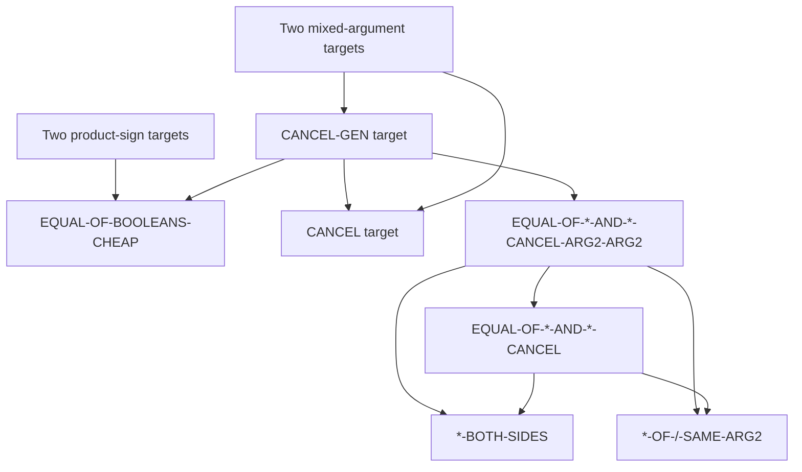

# NS1-R execution record

Dated 2026-09-07. Implements the
[focused plan](../plans/2026-09-07_ns1-replay-mechanisms-plan.md).
**In progress: R1 scope frozen; query captures and selected clause edits underway.**
The [supported scope](2026-09-07_ns1-r-supported-scope.md) records the cases,
module contracts, integration bounds and subsequently selected reuse witnesses.
The selected clause-edit fragment closes the first required CANCEL proof.
Shared query consumption and residual clause construction remain incomplete.

## Baseline and preservation

The goal was activated with the objective in the user's attached text.
The preceding interrupted activation made no implementation progress;
process inspection found no surviving ACL2Lean build or capture to resume.
Work continues in `mdd/ns1-bvchop`. The planning documents are checkpointed
at `7369381`, following implementation HEAD `7598d0a`.

The inherited diff is limited to `NumericComponents.lean`,
`Replay/Driver/ComplexViews.lean`, and `Replay/Driver/Discharge.lean`.
It adds primitive component/negation normalization inside actual emitted
verdict leaves. It does not add an ordinary theorem to the core registry.
The source inspection and a copy of this exact patch precede new replay
implementation; its separate fast-gate checkpoint is `435a26f`.

[The R0 manifest](2026-09-07_ns1-r-baseline.json) records 22 source/capture/image identities,
the inherited patch hash, Lean 4.33.0, production ACL2
`fd27e59021cf7d0103a526dbda41553ad709eae3`, and diagnostic ACL2
`df7a28e38c5122d987fc0bc3c19a0db3895105b6`. The diagnostic checkout is clean.
All 55 source hashes in the selected bootstrap capture's diagnostic manifest
match that checkout. Its saved image matches the earlier successful build
record and the times capture's image timestamp. The captured image core is
241,948,208 bytes, SHA-256
`5c28de5c83d5b42d4f225cf698fd17f13df7dfbe502678c4ca5b64841a168f2f`.
These are engineering provenance checks, not a kernel guarantee of attribution.
Available disk at entry: 1.1 TiB; no cleanup was needed.

Fresh R0 commands, from the NS1 worktree:

```sh
lake env bash -c 'export LEAN_PATH="$PWD/.tmp/ns1:$LEAN_PATH"; exec lean -o .tmp/ns1/NS1Probe/Components.olean .tmp/ns1/NS1Probe/Components.lean'
lake env bash -c 'export LEAN_PATH="$PWD/.tmp/ns1:$LEAN_PATH"; exec lean -o .tmp/ns1/NS1Probe/Negations.olean .tmp/ns1/NS1Probe/Negations.lean'
lake env bash -c 'export LEAN_PATH="$PWD/.tmp/ns1:$LEAN_PATH"; exec lean .tmp/ns1/probe-strict-arithmetic-dependencies.lean'
```

The first two commands exit zero, replaying **24 + 7 declarations
unconditionally**. Component staging enforces the accepted axiom set; all
seven negation axiom receipts were also inspected and accepted. Sources and
captures are unchanged. Receipts: `r0-components.log` and `r0-negations.log`
under `.tmp/ns1-r/`. IMAGPART-OF-- takes 3747 ms and REALPART-OF-- 3555 ms
in the reported replay interval, excluding module loading.

The third command reproduces four failed targets and two conditional
corollaries in `r0-six-dependencies.log`. It is an observational probe whose
process can succeed despite failed rows; it is **not** the final acceptance
test. Its first failures remain the Boolean hypothesis queries and recorded
literal deletion. The final six-theorem test must enforce unconditionality.

R0's fresh static recipes pass in `r0-static.log`; the affected build passes
3167 jobs in `r0-affected-build.log` (existing build artifacts reused where
valid), and focused equality-reasoning replay checks 3/3 unconditionally with
two checked DP leaves in `r0-equality-replay.log`. All receipts are under
`.tmp/ns1-r/`.

The last full gate remains
`.gate-runs/a38c7f5-20260907T095722Z.log` (`TRUE_EXIT=0`), preserving 116
unconditional rows and 21 mirrors. R0 is not a new full-gate claim.

## R1: inspection beyond the first failure

[`scripts/replay-mechanism-inventory.lean`](../../scripts/replay-mechanism-inventory.lean)
traverses all constructors in reconstructed clause/item/node trees and emits
JSONL with theorem, structural address, processor input, branch segments,
rune/USE evidence and query/edit records. It does not attempt replay, turn
recorded contexts into assumed facts, or classify an occurrence as supported.
An initial formatting error in the script was corrected before the successful
run; the first run is not an inventory receipt.

```sh
lake env lean --run scripts/replay-mechanism-inventory.lean \
  .tmp/ns1/c2-clausify-reductions-times-capture/times.proof-log \
  .tmp/ns1-r/r1-times-trees.jsonl \
  '<-OF-*-AND-0' '<-OF-0-AND-*' '<-OF-*-AND-*-CANCEL' \
  '<-OF-*-AND-*-CANCEL-GEN' '<-OF-*-AND-*-CANCEL-ARG1-AND-ARG2' \
  '<-OF-*-AND-*-CANCEL-ARG2-AND-ARG1' '<-OF-*-AND-*-SAME-HELPER'
```

The first successful version emitted 6180 records, 9,601,887 bytes
(`r1-inventory-rerun.log`). A subsequent version retains full provenance for
every node, including rewrite paths needed to inspect IF joins; its successful
receipt is `.tmp/ns1-r/r1-inventory-full-provenance.log`. The six targets contain 88 clause nodes
and 607 rewrite-detail nodes; the downstream helper contains 94 clauses and
3095 rewrite-detail nodes. Counts describe this capture, not acceptance quotas.

| Target | Clauses | Rewrite-detail nodes | Known-true recognizer queries | Queries with IF argument | Substitutions: delete / retain |
| --- | ---: | ---: | ---: | ---: | ---: |
| `<-OF-*-AND-0` | 13 | 29 | 2 | 1 | 0 / 0 |
| `<-OF-0-AND-*` | 12 | 30 | 2 | 1 | 0 / 0 |
| `<-OF-*-AND-*-CANCEL` | 29 | 298 | 0 | 0 | 6 / 0 |
| `<-OF-*-AND-*-CANCEL-GEN` | 28 | 196 | 10 | 3 | 3 / 5 |
| `<-OF-*-AND-*-CANCEL-ARG1-AND-ARG2` | 3 | 27 | 0 | 0 | 0 / 0 |
| `<-OF-*-AND-*-CANCEL-ARG2-AND-ARG1` | 3 | 27 | 0 | 0 | 0 / 0 |

All fourteen known-true recognizer records are BOOLEANP with argument/true
masks 384/384 and false mask -385; all carry zero argument leaves. Thus the
nested-conditional gap is visible without first repairing the direct case.

The six trees use only apply-top-hints, preprocess and simplify processors
in this capture. That is not a proof that every nested rewrite/DP obligation
is supported. In particular, CANCEL-GEN has two uses of the ordinary theorem
`EQUAL-OF-*-AND-*-CANCEL-ARG2-ARG2`, at Subgoal 9.2' and Subgoal 5'. That
dependency was hidden behind its first Boolean failure. The separate
`EQUAL-OF-BOOLEANS-CHEAP` book proof is also required. Their complete proof
closure must be inspected before the family scope is frozen.

## Source cases under investigation

Source locations below refer to diagnostic ACL2 `df7a28e38c`, not necessarily
the production checkout's line numbers.

| Source branch | Observation | Design consequence / remaining work |
| --- | --- | --- |
| `type-set-b.lisp:3226`, `type-set-recognizer` | Computes Boolean result by intersections with the enabled tuple's true/false masks and retains its rune | Separate checked argument membership, tuple justification and mask conversion; do not assume a tuple establishes its own theorem |
| `type-set-b.lisp:8120`, `type-set-rec` query observer | Already records executed recursive calls and selected lookup/comparison/recognizer metadata when dynamically enabled | Reuse this observer for hypothesis consumers where possible; first inspect its IF and context coverage |
| `type-set-b.lisp:8393`, recognizer argument | Captures the actual consumed argument mask and tuple | Outer summaries alone do not provide the argument's branch derivations |
| `type-set-b.lisp:12819`, `known-whether-nil` | Publishes root recognizer/comparison summaries; root IF uses a separate collector | Inspect and consolidate the two evidence routes before changing the consumer |
| `type-set-b.lisp:12021`, `tp-collect-if-leaves1` | Diagnostic re-query of branches using `assume-true-false-rec` and `type-set` | It is not an observation of the original query's executed children; retain that distinction in the capture design |
| `simplify.lisp:6679`, `subst-equiv-and-maybe-delete-lit` | Skips the selected literal while substituting elsewhere; deletes or retains it; rebuilds through add-literal | Shared clause transition needs implication and exact ordered cleanup, not only equality transport |
| `simplify.lisp:6737`, `remove-trivial-equivalences-rec` | Repeats selected edits; records selected input, position, equality and deletion flag | Inventory all successive edits and child endpoints; do not select a different capture to avoid deletion |

The source's actual IF query branch is `type-set-b.lisp:8433`: it calls
`assume-true-false-rec`, then either uses the true branch, uses the false
branch, unions both returned masks, or reports an empty type for contradictory
context. `type-set-finish` can then intersect with prior lookup information.
These cases must be distinguished in the evidence; positional child terms
alone do not describe the branch contexts or the pruned branch's justification.

## Additional dependency probes and downstream baseline

The unchanged `equal-of-booleans.lisp` was captured afresh with the preserved
diagnostic image: 2/2 QEDs, 600 lines, full source. Capture and sidecar are in
`.tmp/ns1-r/equal-booleans-capture/`; receipt is `r1-equal-booleans-capture.log`.
This diagnostic used the existing capture worker mode because it writes a
new scratch file that no compiled include-string consumer references; it does
not recapture or change an existing embedded input. Production promotion must
still invalidate affected consumers under the normal protocol.

The tree inventory now also covers both Boolean-book proofs and four ordinary
equality-cancellation dependencies from the existing times capture. Their
full-provenance outputs are `r1-equal-booleans-trees.jsonl` and
`r1-equality-dependency-trees.jsonl`, with matching `*-full-provenance.log`
command receipts under `.tmp/ns1-r/`.

The actual dependency graph contains these additional edges:



This is the newly inspected ordinary-rule subgraph, not the complete list of
primitive, type, totality or bootstrap obligations. The Boolean recognizer's
named bootstrap theorem is itself an ordinary `defthm` at `axioms.lisp:2269`;
its original initialization proof was captured and replayed separately (receipt below). POSITIVE,
used by CANCEL, is an actual primitive axiom at `axioms.lisp:4340` with an
existing checked model schema.

`.tmp/ns1-r/probe-dependencies.lean` uses the existing staged driver against
the five additional ordinary dependency trees. Its completed observational
run is `r1-dependencies-replay.log`:

| Dependency | Actual result | Scope assessment still required |
| --- | --- | --- |
| `*-BOTH-SIDES` | Unconditional, accepted axioms; 790 ms | Existing machinery suffices |
| `*-OF-/-SAME-ARG2` | Residual executable fold changes no surviving literal at Goal' | Shared edit machinery must account for recorded temporary construction/folds; do not simply accept every ineffective step |
| `EQUAL-OF-*-AND-*-CANCEL` | Recorded DP leaf fails after zero substitution; 42,516 ms | Inspect primitive completion and the exact leaf before assuming the new query/edit modules will solve it |
| `EQUAL-OF-*-AND-*-CANCEL-ARG2-ARG2` | IF OR-copy reconstruction ends at FIX while the recorded test has FIX's expanded body | Trace the recorded rewrite paths and classify this existing composition defect before freezing scope |
| `EQUAL-OF-BOOLEANS-CHEAP` | IF Boolean collapse cannot obtain Y's two-valuedness | The actual branch contains `(NOT (BOOLEANP Y))` as a false literal; shared checked-context membership must expose that premise |

The no-effect folds are repeated recorded `(UNARY-/ '0) → '0` calls and
`(BINARY-* '0 '0) → '0`, within the original substitution continuation.
The IF-copy mismatch has an actual `FIX X` expansion preceding the combined
node; the current bridge excludes window-tagged prefix nodes when selecting
the test proof. This is an identified consumer boundary, not yet a verified
repair or authorization to ignore the endpoint check.

The baseline whole helper also ran with all 31 checked stage declarations:

```sh
lake env bash -c 'export LEAN_PATH="$PWD/.tmp/ns1:$LEAN_PATH"; exec lean .tmp/ns1-r/probe-helper.lean'
```

`r0-helper-replay.log` reports a failure after **178,789 ms** at Subgoal 2':
literal item 6 is quoted T, while the next clause literal is
`(< (BINARY-* X1 Y) (BINARY-* X2 Y))`. It did not hit the earlier heartbeat
timeout in this run. This is an actual remaining composition boundary; no
complete helper or conditional whole-helper proof is claimed.

The original initialization capture for BOOLEANP-COMPOUND-RECOGNIZER completed
with `initialize-acl2 nil`, unchanged original theorem arguments/hints, a clean
producer, and an explicit completed observation window. Raw stdout and its
Latin-1-to-UTF-8 transcription are retained separately under
`.tmp/ns1-r/bootstrap-boolean-capture/`, with 55 source hashes and driver/script
identities in `diagnostic.json`. Decompressed UTF-8 SHA-256:
`ec7d3cdc46b27852f4d36d2dce17bff8d26fd2a8191bcbcfd7395747a6732045`.
The inventory reconstructs one clause. The CLI checks 1/1 unconditionally
(429 ms reported theorem replay), without a DP leaf. A second probe at the
quotient consumer world enforces an empty condition inventory and accepted
axioms, then runs `#print axioms R1Bootstrap.booleanRecognizer`. Both succeed:

```sh
lake env lean .tmp/ns1-r/probe-bootstrap-boolean.lean
```

Receipt: `r1-bootstrap-boolean-consumer-world.log`. This is a complete ordinary
bootstrap replay, not a handwritten registration of its corollary.

R1 now freezes the source-case and integration envelope in the supported-scope
note. No inspected mandatory dependency has yet demonstrated a need for an
excluded mechanism. That assessment is bounded: the IF window mismatch may
only be repaired by correctly routing its already recorded rewrite, and the
zero-product verdict may only use existing primitive semantics inside that
emitted leaf. An unrecorded inference or new arithmetic mechanism would be
an incomplete-stop finding. No new semantic lemma or replay dispatch case has
been added under NS1-R yet. The next package is R2's executed-query capture
and real-source probes; the missing recursive/branch evidence remains open.

The R1 inventory/scope checkpoint passes a fresh fast gate: static recipes in
`r1-static.log`, affected build (3167 jobs) in `r1-affected-build.log`, and
3/3 unconditional equality-reasoning replay in `r1-equality-replay.log`.
The inventory script compiled and traversed the source trees as recorded
above. This checkpoint changes the inspection tool and records; it makes no
new production replay or full-gate claim.

## R2 query observations and first edit implementation

The scope/inventory checkpoint is `b8f9034`. The diagnostic producer then
added executed known-true and scoped IF query observation (`4ad3e3248d`),
followed by original explicit-recognizer and IF-Boolean-collapse query
observation (`af782a07afae25b9370d9fa3f85eb4bb55f91ce6`). Both changes only
observe original calls; the older addressed-leaf collectors remain explicitly
separate diagnostic re-queries. Nested original queries are appended back to
their parent observer in execution order. No mandatory source or hint changed.

The first diagnostic image rebuild passed but its first TIMES capture failed
at the system include of equal-of-booleans: the image defaulted to the
absent diagnostic `books/` directory. The failed raw output is retained in
`r2-query-times-capture/`; no successful log or sidecar was published for it.
An explicit `ACL2_SYSTEM_BOOKS` path to the existing production books fixes
the environment. Clean producer rebuilds then succeed, with matching image
banner/commit, and captures use that explicit system path.

Latest capture command pattern (new scratch outputs have no embedded consumer):

```sh
ACL2_SYSTEM_BOOKS="$PWD/acl2/books" \
ACL2="$PWD/.tmp/ns1/acl2-ta-singleton/saved_acl2" \
OUTDIR="$PWD/.tmp/ns1-r/r2-query-all-consumers-times-capture" \
CAPTURE_WORKER=1 CAPTURE_THROUGH='<=-OF-*-AND-*-SAME-FORWARD-2' \
scripts/capture-proof-log.sh acl2/books/kestrel/arithmetic-light/times.lisp
```

The latest TIMES capture has 38/38 QEDs, 166,796 lines and 10,572,735 bytes
(old selected capture: 6,647,656 bytes). The Boolean book has 2/2 QEDs,
1044 lines and 56,589 bytes. Source/image/capture hashes, all 55 producer
source hashes and the exact system path are recorded in
`.tmp/ns1-r/r2-query-provenance.json`. The final clean build receipt is
`r2-query-consumers-clean-image-build.log`. This remains diagnostic production
work; no production submodule or maintained capture has been promoted.

The first query capture reconstructs the same 6180 inventory rows for all
seven TIMES trees. Its structure, statements, runes and legacy basis projection
are identical to R1 (`r2-query-structural-comparison.json`). That comparison
explicitly omits raw provenance and log identity, so it does not by itself
establish equality of every old metadata field. Source delta inspection and
full metadata comparisons remain part of promotion.

The six targets' fourteen known-true recognizer records expose 127 executed
queries, including seven actual IF queries. All seven take both branches;
their decision prefixes contain two, three or six executed queries. The
Boolean book's formerly failing collapse now records its actual lookup of
Y at mask 384, citing BOOLEANP-COMPOUND-RECOGNIZER. A later Boolean-book
query also retains accumulated ordinary rewrite and SPLITTER-IF-INTRO
citations, an evidence-channel distinction the consumer must preserve.

The authored `.tmp/ns1-r/query-probes.lisp` places its conditional inside an
ordinary rewrite rule's hypothesis, so argument rewriting does not erase the
query beforehand. Real ACL2 captures 6/6 theorems. The complete reconstructed
three consumer trees contain 31 executed queries: three outer both-branch
IFs, one inner true-only IF and one inner false-only IF. These are positive
source observations, not Lean replay successes. The input contains unreachable
non-Boolean branches, making branch pruning material to Boolean membership.
The propagated recognizer tuple contains a numeric enabled-rule index
(`1040`) where the old query checker assumes NIL; the tuple's semantic fields
and its source index must be distinguished. The contradictory-context IF
case is not yet witnessed. Receipts: `r2-query-probes-capture.log`,
`r2-query-probe-inventory.log`, `r2-query-probe-trees.jsonl`.

Parser/tree WIP retains the new hypothesis query envelope; the inventory
walk now exposes both hypothesis and operand query trees. No shared query
consumer has been implemented yet. In parallel, the already inventoried
selected EQUAL edit now has a fragment-local selection record and an explicit
`ClauseEditSound w env before after` implication judgment. The linear
continuation calls it for both retention and deletion. Quote-opaque replacement
was moved out of the residual postpass without changing its implementation.
The selected equality is used inside the parent contradiction and is not
added to the child's assumptions. Two compile errors (a mutable binding name
and a missing direct import) were fixed; `r3-selected-clause-edit-build-final.log`
now builds the replay executable. The actual owning proof `<-OF-*-AND-*-CANCEL` now replays unconditionally
through all six selected deletions, taking 19,874 ms in the reported replay
interval. `probe-selected-edit-cancel.lean` fails unless the condition list is
empty and the axiom set is accepted; its additional `#print axioms` confirms
`{propext, Classical.choice, Quot.sound}`. Receipt:
`r3-selected-edit-cancel.log`. This uses the preserved original TIMES capture;
acceptance through the new query consumers and maintained captures is still
required. It is one required whole proof, not completion of either family.

Both staged modules were freshly recompiled after the parser/edit changes:
24 component and seven negation declarations remain unconditional, with
accepted axiom receipts (`r3-selected-edit-components.log`,
`r3-selected-edit-negations.log`). The two existing retention postpasses
kernel-check relative to their actual recorded children and reject all 26
existing mutations. The new deletion controls use actual CANCEL Subgoals
2.9 and 2.8, check the same conditional child contract, and reject 26
mutations including a removed deletion decision and missing cleanup/child.
Receipts: `r3-selected-edit-retention-controls.log` and
`r3-selected-edit-deletion-controls.log`.

The latest full six-tree query inventory, including explicit recognizer and
Boolean-collapse operands, contains 312 recursive queries in 80 envelopes
(14 hypothesis, 66 operand). The new operand observations include negation
and addition queries narrowed by existing contexts; these must pass through
the shared membership judgment as well. Raw counts describe this capture,
not a support claim. Residual consumer consolidation, temporary construction
capture, query consumers and all final acceptance checks remain open.

The next query integration uses the existing whole-formula dependency
transport to offer cited ordinary recognizer proofs explicitly. The Boolean
case must consume the instantiated replayed equivalence, rather than merely
retain an unused proof alongside a primitive Boolean law. Lookup and
recognizer application then share this checked relation in opposite
directions. Inherited ttree tags are distinguished from newly selected query
evidence; their presence is not permission to assume an ordinary theorem.
Primitive negation's new recorded result masks will be handled by the source's
finite atomic-type transfer, not a theorem-indexed list of additional masks.

The selected-edit increment passes its fast gate: all static recipes in
`r3-selected-edit-static.log`, updated BUGS/pattern-map checks in
`r3-selected-edit-record-checks.log`, and six affected test targets in
`r3-selected-edit-affected-build.log` (3169 jobs; Ns1Mod's fresh build takes
246 seconds). Focused EQUAL-DENOMINATOR-1 replay is unconditional in
`r3-selected-edit-denominator-replay.log`; it checks the extracted replacement
helper on the existing residual route, and does not yet count as acceptance
through the future shared residual edit consumer. There is no new full
claim-gate receipt.
